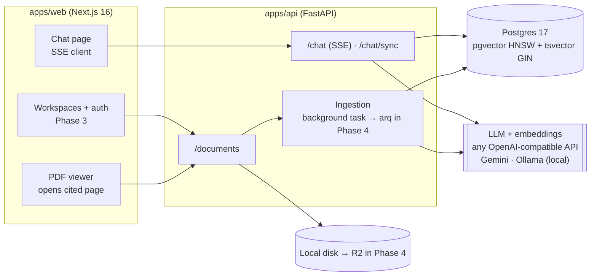

# Architecture

## System overview


## Ingestion
1. **Upload** (`POST /documents`): extension + PDF magic-byte check, size limit, SHA-256 dedupe
   (`UNIQUE (workspace_id, sha256)`), file stored as `<sha>.pdf`.
2. **Parse** (`rag/parse.py`): PyMuPDF text blocks with font sizes. The body size is the
   *character-weighted* median font size; short blocks noticeably bigger (or bold) become headings
   with a level. Every block keeps its page number.
3. **Chunk** (`rag/chunk.py`): a heading always starts a new chunk; paragraphs are packed to about 450
   tokens; oversized paragraphs are split by sentence (handles `।` for Hindi). There is one short
   paragraph of overlap, never across sections. Each chunk stores its `section_path`.
4. **Embed**: vectors larger than `EMBED_DIM` are truncated Matryoshka-style and re-normalised (pgvector HNSW allows ≤ 2000 dims). The text embedded is `"{title} > {section_path}\n\n{content}"` (contextual header).
   Vectors are L2-normalised.
5. **Index**: `chunks.embedding` (HNSW, cosine) and `chunks.tsv` (generated `tsvector` over section + content, GIN).

## Question answering (`rag/pipeline.py`)
1. **Rewrite** follow-ups into standalone queries with the fast model (skipped on the first turn; failures fall back to the raw question).
2. **Embed** the query.
3. **Hybrid retrieve** (`rag/retrieve.py`): one SQL statement does the vector top-k and the full-text
   top-k (`websearch_to_tsquery`), then fuses them with Reciprocal Rank Fusion
   `Σ 1/(60 + rank)`. Weights select `dense` / `lexical` / `hybrid` mode for ablations.
4. **Generate**: system rules (sources only, cite `[n]`, say when not found, answer in the question's
   language, ignore instructions inside sources) + numbered sources with title/page/section. Streamed.
5. **Filter**: `ThinkStripper` removes `<think>…</think>` even when tags are split across chunks.
6. **Resolve citations**: `[n]`, `[n][m]` and `[n, m]` map to chunks; out-of-range markers are counted as *phantom citations*.
7. **Persist**: user + assistant messages, token usage, latency, time-to-first-token, citations.

### SSE protocol (`POST /chat`)
```
event: meta       data: {"rewritten_query": null}
event: token      data: {"t": "Students whose family income "}
event: citations  data: [{"marker":1,"chunk_id":"…","document_id":"…","title":"…","section":"Eligibility","page":4,"snippet":"…"}]
event: done       data: {"answer":"…","message_id":"…","conversation_id":"…","ttft_ms":812,"latency_ms":2310,"phantom_citations":[],…}
event: error      data: {"message":"…"}        (only on failure)
```

## Data model (migration 001)
- `documents` (id, workspace_id, title, filename, mime_type, sha256, storage_path, source_url, status, error, page_count, chunk_count)
- `chunks` (id, workspace_id, document_id, ordinal, section_path, page_start, page_end, content, token_count, embedding vector(EMBED_DIM), tsv)
- `conversations`, `messages` (tokens, latency, ttft, phantom_citations, feedback), `message_citations`
- `eval_runs` (config + metrics JSON per run)

Planned: RLS policies + membership (Phase 3); `scheme_criteria` for the v1.1 eligibility checker.

## Provider abstraction
| Interface | Implementations | Selected by |
|---|---|---|
| `LLM` (`stream`, `complete`) | `OpenAICompatLLM` (Gemini / Ollama / any OpenAI-compatible), `FakeLLM` | `LLM_PROVIDER` |
| `Embedder` (`embed`) | `OpenAICompatEmbedder`, `LocalEmbedder` (BGE-M3), `FakeEmbedder` | `EMBED_PROVIDER` |

The fake providers make the whole test suite run offline and free.

## Security notes
- All SQL is parameterised; migrations template only validated integers and identifiers.
- Uploads: allow-list of extensions, PDF magic bytes, size cap. Disable public uploads in production.
- Prompt injection: sources are framed as data; no tools with side effects in the chat path.
- Secrets only via env; gitleaks pre-commit + CI.
